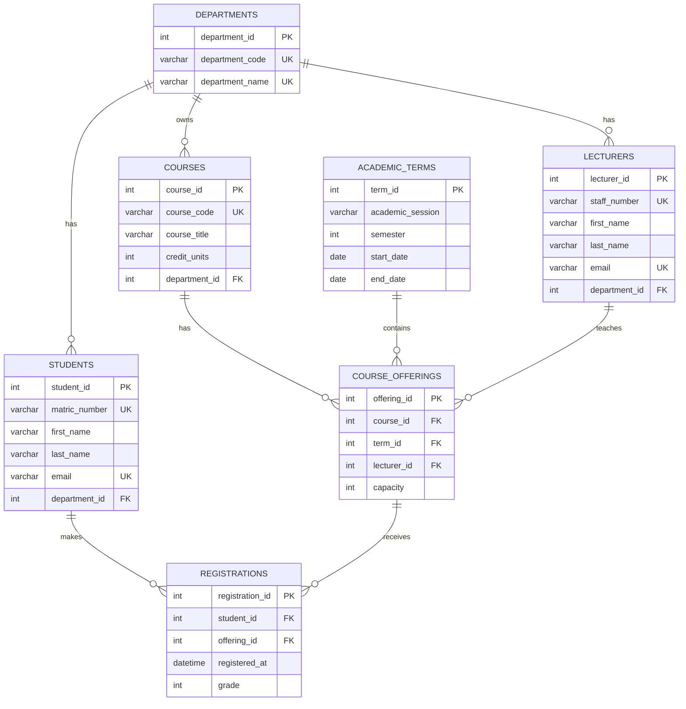

# Portfolio 1: Entity–Relationship Diagram

This diagram describes the proposed CampusFlow relational database.

## Composite Unique Constraints

The following combinations must be unique:

| Table | Unique combination | Purpose |
|---|---|---|
| academic_terms | academic_session, semester | Prevent duplicate terms |
| course_offerings | course_id, term_id | Prevent offering the same course twice in one term |
| registrations | student_id, offering_id | Prevent duplicate registration |

The columns within each combination are not individually unique.

## Required and Optional Values

- Every column is required except registrations.grade.
- A missing grade means marking has not yet been completed.
- Each foreign key references exactly one existing parent record.
- A parent record can exist without any related child records.

## Relationship Explanation

Departments have students, lecturers and courses.

Each course offering connects one course, one academic term
and one lecturer.

Registrations connect students to course offerings.
A student can register for many offerings, and an offering
can have many students.

## Rules Beyond the Diagram

The SQL schema will define column lengths, required values,
unique constraints, valid ranges and deletion restrictions.

Offering capacity will be enforced through a transaction
and locking method demonstrated in Portfolio 3.
