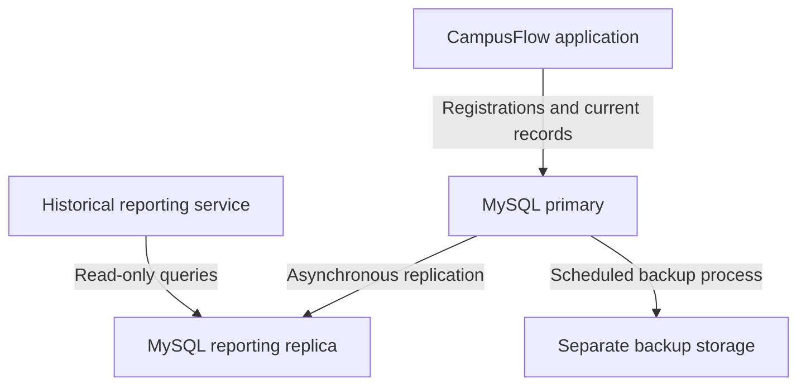

# Portfolio 5: Proposed Distributed and Cloud Architecture

## 1. Scope and Implementation Status

This document proposes a distributed/cloud architecture for CampusFlow.

The implemented databases run locally:
- MySQL supports relational records and transactional registration.
- MongoDB demonstrates student term documents.

Cloud deployment, replication, failover and sharding have not been
configured or tested. The architecture below is a proposal.

## 2. CampusFlow Requirements

Course registration creates a critical consistency requirement:
two students must not both receive the last available place.

Other workloads have different requirements:

| Operation | Proposed requirement |
|---|---|
| Register for a course | Authoritative capacity check and transactional write |
| Confirm a new registration | Read committed results from the primary |
| Record a grade | Authorised transactional write |
| Produce historical enrolment reports | Some replication delay may be acceptable |
| Display a cached term summary | Show its refresh time if it may be stale |

Acceptable reporting delay would need agreement with university staff.

## 3. Proposed Architecture

The diagram represents a proposed logical architecture.
It is not evidence of a running deployment.

The primary handles registration writes and reads requiring current
data. A read-only replica serves suitable historical reports.

The proposed application and reporting service have not been built
as part of this database portfolio.

## 4. Replication

MySQL supports asynchronous source-to-replica replication [1].

For CampusFlow, a replica could reduce reporting work on the primary
and maintain another copy of the database.

Asynchronous replication does not guarantee that the replica has
applied a newly committed transaction when it is queried.

For example, after the primary accepts BIO101's final registration,
a delayed replica might still display one available place.

Therefore:
- Capacity decisions must use the primary.
- Registration confirmation must use the primary.
- A replica's displayed availability must not authorise registration.
- Reporting should account for replica lag.

Replication improves the architecture's options for recovery and
read distribution, but adding a replica alone does not establish
automatic failover.

## 5. Transaction Consistency

The registration procedure from Portfolio 3 locks the offering,
counts registrations and inserts only if capacity remains.

In the proposed architecture, all registration requests must reach
the current primary and follow this procedure.

The offering row lock coordinates those transactions on that server.
It does not coordinate independent writable copies on unrelated
servers.

A production application account should be permitted to execute
the approved registration procedure without unrestricted direct
inserts that bypass capacity checks.

Capacity changes would also need a controlled transaction.

## 6. Availability and Failover

If the application loses access to the authoritative primary,
it should temporarily stop accepting registration writes.

Historical reports could continue from an accessible replica,
provided users are informed that the data may be stale.

Promoting an asynchronous replica requires checks:
1. Establish whether the original primary is truly unavailable.
2. Prevent the old primary from continuing to accept writes.
3. Assess the candidate replica's replication position.
4. Decide whether any unapplied transactions imply data loss.
5. Redirect clients and verify the promoted server.

This avoids assuming that any available replica is automatically
a safe replacement.

A possible future alternative is MySQL Group Replication in
single-primary mode, which provides one read/write primary [2].
That is a different topology requiring its own configuration,
routing, consistency choices and failure testing.

No failover time or zero-data-loss guarantee is claimed here.

## 7. Network Partition Trade-off

Consider a network failure that separates the application from
the authoritative registration database.

CampusFlow should not accept a registration locally and promise
the last place without checking authoritative capacity.

The proposed policy sacrifices registration availability during
that failure to preserve the capacity rule.

Noncritical historical reporting may tolerate older data.

This is a workload-specific design decision, rather than a claim
that every operation in the system has identical consistency needs.

## 8. Sharding

Sharding distributes different portions of data across servers [3].

The current dataset does not demonstrate a need for sharding.
Indexing and query design should be evaluated before adding that
operational complexity.

Sharding MySQL registrations by student department would complicate
capacity checks because students from different departments can
register for the same offering.

Partitioning registration work by offering identifier would keep
an offering's registrations together, but student-wide reports
could then need information from multiple partitions.

This is a conceptual application-sharding option, not an implemented
MySQL feature in this project.

For a much larger MongoDB student_term_records collection, a
student-based shard key could be evaluated because the main access
pattern retrieves a student's term records.

A final key should be selected only after examining query patterns,
value distribution and write concentration [4].

Department alone would be a poor candidate for this example:
it has only three values and could distribute work unevenly.

No shard key has been implemented or benchmarked.

## 9. Cloud Deployment and Recovery

A future deployment could place the primary and replica on
separate cloud database instances in separate failure domains.

Before selecting a provider, evaluate:
- Supported MySQL versions and required features.
- Backup and restore capabilities.
- Replication and failover behaviour.
- Network connectivity and latency.
- Data location requirements.
- Operating and storage costs.

Proposed controls include private database networking, encrypted
connections, restricted application accounts and protected secrets.

Separate backups are needed because replication can also propagate
accidental updates or deletions.

Restore exercises should verify that backups are usable.

The university would need to define:
- Recovery Point Objective: acceptable loss of recent data.
- Recovery Time Objective: acceptable service recovery time.

Neither objective has been measured in this project.

## 10. Relationship to the MongoDB Model

The Portfolio 4 documents are manually prepared snapshots.
There is no implemented synchronisation pipeline from MySQL.

If MongoDB were later used for read summaries, CampusFlow would need
a reliable refresh mechanism, error handling and visible refresh times.

Writing independently to MySQL and MongoDB would introduce partial
failure risks. A successful write to one database does not prove
that the other was updated.

The proposed system therefore keeps MySQL authoritative for course
registration.

## 11. Proposed Validation Plan

| Future test | What it should establish |
|---|---|
| Concurrent requests for the last place | Capacity remains respected |
| Delay replica updates | Confirmation and capacity checks still use the primary |
| Disconnect the primary | Registration does not report false success |
| Promote a replica | Old primary cannot accept conflicting writes |
| Restore a backup | Data can be recovered and checked |
| Interrupt summary refresh | Stale MongoDB summaries are detectable |

These tests are planned, not completed.

## 12. Conclusion

The proposed first step is a single writable MySQL primary with
a reporting replica and separate backups.

Registration prioritises authoritative transactional checks.
Suitable historical reports can tolerate explicitly managed staleness.

Sharding is deferred until workload evidence justifies it.

## References

[1] MySQL 8.0 Reference Manual: Replication.
https://dev.mysql.com/doc/refman/8.0/en/replication.html

[2] MySQL 8.0 Reference Manual: Group Replication Single-Primary Mode.
https://dev.mysql.com/doc/refman/8.0/en/group-replication-single-primary-mode.html

[3] MongoDB Manual: Sharding.
https://www.mongodb.com/docs/manual/sharding/

[4] MongoDB Manual: Choose a Shard Key.
https://www.mongodb.com/docs/manual/core/sharding-choose-a-shard-key/

## AI Assistance

ChatGPT assisted with the architecture discussion and documentation.
The proposal must be reviewed and explained by the student.
No cloud implementation or failure-test results are asserted.
